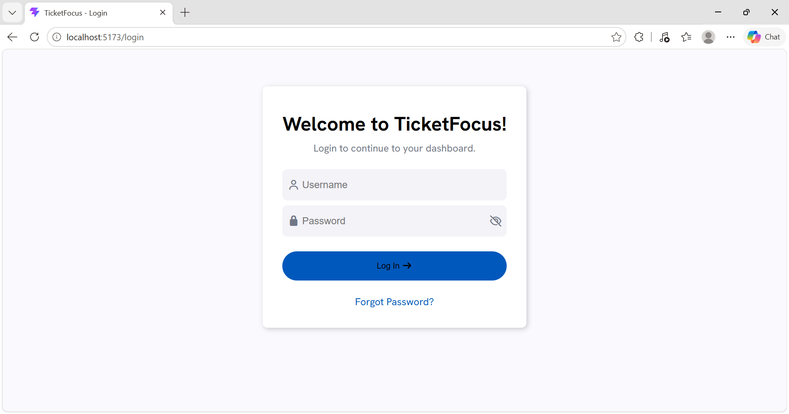
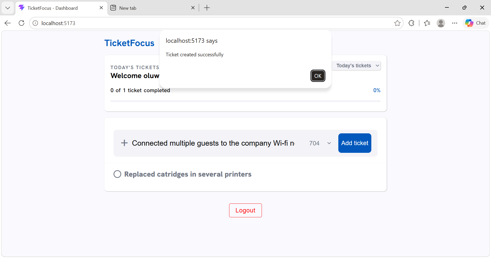
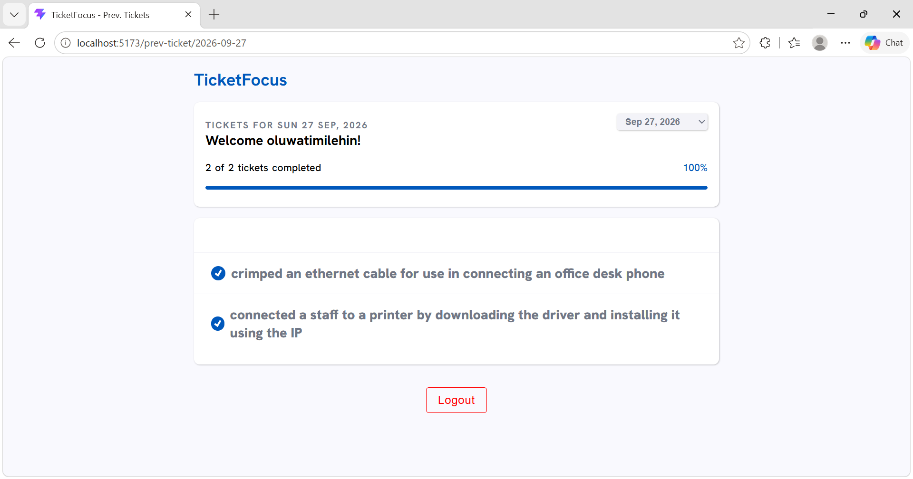

# TicketFocus

A simple **Ticketing Application** built with **ReactJs and NodeJs** as my SIWES project.

**TicketFocus** is a ticketing application where IT support staff can submit their tickets (a ticket is any IT Support task carried out) and the IT Support Officer, with admin access can view the tickets of all employees.

The purpose of this project is to demonstrate the integration of MySQL, a popular relational database, with Node.js, a runtime environment for executing JavaScript code. The project showcases the ability to perform CRUD operations (Create tickets, Read tickets, Update tickets, and Delete tickets) on MySQL tables using Node.js, along with issuing queries to retrieve specific data from the database. CRUD operations are those operations that allows users to manipulate and interact with data stored in the database. The admin may also perform CRUD operations to Create a new user, Read the details of existing users, Update the details of existing users and Delete an existing user.

It is my first full-stack project on my journey to becoming a full-stack dev. I am excited to have worked on it. I learned a lot.

---

## Features

- **User Authorization and Authentication**
  - Users login using their login credentials gotten from the DB administrator
  - These credentials allow access to their dashboard in order to create and modify their tickets.
  - Their authentication session lasts for 2 days after which they’ll need to login again.
  - Users cannot access any page without being authenticated.

- **Create Tickets**
  - Authenticated users can create tickets on their dashboard.
  - The dashboard displays tickets created on that day.

- **Update Tickets**
  - A user can update the ticket description, completion status of the tickets and edit the office a task was carried out.

- **View Past Tickets**
  - There is a page where an authenticated user can revisit tickets created previously.

- **Admin Control**
  - The admin has access to pages that are restricted from other users. e.g the users page for managing the user profiles.

- **View Tickets' completion status**
  - There is a progress bar for monitoring the number of complete tickets.

- **Database Interation**
  - A sql database is utilized for storing tickets and user data.

---

## Screenshots





---

## Technologies used

- ReactJs
- NodeJs
- ExpressJs
- JWT
- Axios
- BycryptJs
- Jsonwebtoken(JWT)
- MySql2

---

## Installation / Usage

1.  Install the required dependencies:
    - install a code editor (Vs code is recommended): [VS Code software download](https://code.visualstudio.com/download)
    - nodejs: [NodeJs installer download](https://nodejs.org/en/download)
    - mysql: [MySql installer download](https://dev.mysql.com/downloads/installer)
2.  Clone the repository:

```bash
git clone https://github.com/timdare/ticketfocus.git
```

3. Setup a database connection and import mysql file:
   - Launch MySql Workbench.
   - Delete the default connection: Right-click on the connection that exists and click “delete connection”. ***This step is entirely optional***.
   - Add a new connection by clicking the add icon next to MySql Connection.
   - Enter a connection name e.g “localhost”. You can keep the default values for the rest of the input fields. Click on ok.
   - Click on the connection you have just created, enter your password and click ok to login.
   - In the navigation tab, click on server > data import.
   - Click “import from self-contained file” and click the three-dots-menu next to the file path to navigate to the ticketfocus project.
   - Inside the project folder, navigate into ticketfocus.sql. The file path is ticketfocus > ticketfocus-backend > db_export > ticketfocus.sql. Open this file to import the database with some existing data.

4. Open the project folder in your code editor:
   - In your code editor, open the TicketFocus project folder. In VS code, enter `ctrl + k + o` on Windows or `cmd + k + o` on Macbook.  
5. Setup an env file with your own variables
   - Click on the file icon to open the explorer tab.
   - Right click on ticketfocus-backend and create a new file. Name it “.env”.
   - Open the “.env.example” file and copy the text there to your .env file. Replace the values with your own values.
6. Start the backend and frontend of the project:
   - Open a new terminal by clicking ``ctrl + shift + ` `` on windows or ``cmd + shift + ` `` on Macbook.
   - Change directory into the backend folder and run `npm install` to install all the packages needed. You need an internet connection for the installation.
   - Enter the command `npm run server` to start the backend.
   - Again, open a new terminal by clicking ``ctrl + shift + ` `` on windows or ``cmd + shift + ` `` on Macbook.
   - Change directory into the frontend folder and run `npm install` to install all the packages needed. You need an internet connection for the installation.
   - Enter the command `npm run dev` to start the backend.
   - Go to your browser and search ‘http://localhost:5173’. You will be redirected to the login page.

## Future Improvements

- [x] Add 'Page not found' page
- [ ] Add all users and all tickets pages for admin
- [ ] Add custom popup modals instead of alert boxes
- [ ] Add reset password page
